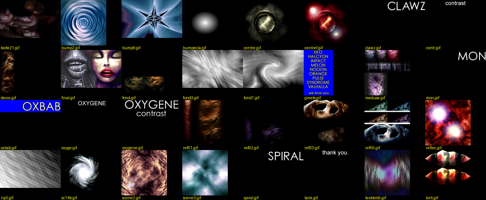
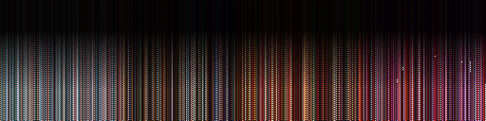
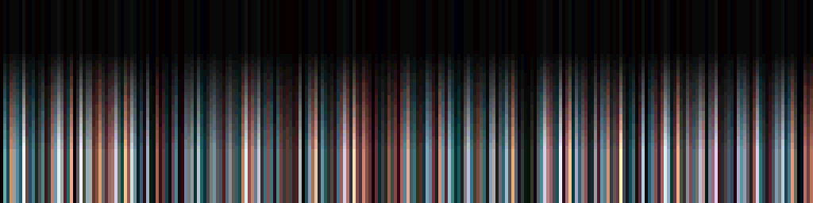

# CONTRAST (Oxygene, 1996) - effects, 3D engine, scenes

*CONTRAST* by **Oxygene** (code OXBAB, 3D graphics SPIRAL and MON, music CLAWZ/Impact, sound system MIDAS 0.50a). A DOS/4GW (Watcom C/C++32) executable of 405 KB,
a 2.6 MB data archive `CONTRAST.BIN` (59 files) and a 12-channel FastTracker 2 module `CONTRAST.XM`. The recorded run lasts 560 s (39,243 ticks).

Everything below was read in the disassembly (`oxg_out/code.asm`) and in the port (`oxg_web/src/*.js`, one module per routine group; every scene is a class with
`step(sync) -> {frame, pal}`, one call = one 70 Hz tick). Longer reference material is in `oxg_out/REVERSE.md` and `oxg_out/EFFECTS.md`; the asm tricks are in
`WRITEUP-asm.md`.

## 0. What is exact and what is not

* **Frames and palettes are exact** against a recording of the real program run under emulation (Unicorn, flat 32-bit, virtual VGA/PIT, MIDAS in "No Sound" mode):
  `node oxg_web/test/test_seq.js` runs the whole chain and reports zero differing ticks, except tick 23,511 where the recording itself caught the program half-way
  through its own screen update (`oxg_out/EFFECTS.md`, section 7). Single routines were also checked against memory dumps (`test_*.js`). I did not re-run the tests for this write-up; the figures are those stated in `oxg_out/EFFECTS.md` and `oxg_web/README.md`.
* **Timing is the part that is not a derivation.** Scene starts and ends are driven by *sync values* that the module sets (section 1). The web page does not run MIDAS: it feeds
  the scenes a table of sync values recorded from the emulated run (`site/assets/sync.json`), and plays the module rendered with libopenmpt, time-warped row by row to the
  emulated MIDAS timing. In "No Sound" mode MIDAS plays about 3.6 % slower than nominal (`oxg_out/EFFECTS.md`); the behaviour on a real sound card could not be observed.
* **Aspect ratio.** The demo is VGA mode 13h, 320x200, 256 colours, pixels not square. The web page stretches the 320x200 picture to 4:3 with CSS (`oxg_web/README.md`).
  The 3D engine itself corrects for it: the camera matrix's y row is scaled by 512/596 (section 4.2).

## 1. Clock, script and palette

* **Frame counter from the retrace.** At start-up (0x102DB) the program waits for three retraces on port 0x3DA, programs the PIT (mode 3, count 0), times one retrace and
  re-programs the timer interrupt so that it fires once per frame. The counter `[0x44E20]` is then a frame counter and "wait for the next frame" is three instructions
  (0x102CB). The recorded run gives 70.09 ticks per second.
* **Music as the script.** The main routine (0x10564) calls nine scene routines in order. Each one waits for a value of the module's *sync* word (read from MIDAS in the
  main loop; edges `1 -> 0`, then 3, 4, ... 0xD). The scene code contains no timeline of its own beyond tick counts inside a scene. The port therefore takes the sync value as an
  input of `step(sync)`.
* **Fade tables instead of arithmetic.** `0x10F64` builds 64 palettes (768 bytes of 8-bit components each) from a source and a destination. A fade is `DAC = table[tick] >> 2`.
  The port (`src/fade.js`) is the whole routine:

```js
for (let i = 0; i < 768; i++) {            // src null: from black; dst null: to black
  if (!src) { P[i] = 0; D[i] = dst[i] << 2; }
  else if (!dst) { P[i] = src[i] << 8; D[i] = (-src[i]) << 2; }
  else { P[i] = src[i] << 8; D[i] = (dst[i] - src[i]) << 2; }
}
for (let s = 0; s < 64; s++) for (let i = 0; i < 768; i++) { out[s*768+i] = (P[i] >> 8) & 0xFF; P[i] += D[i]; }
```

  DAC colour 0 is forced to black every tick. Palettes stored in the archive (`textdeb*.bin`, `bump3..5.bin`) are 768 bytes of 8-bit values; GIFs carry theirs inside.
* **Tables built at start-up (0x107AC).** A 4096-entry circle: cos and sin scaled by 32768 *truncated toward zero* (Watcom's float-to-int helper, see the asm write-up), and
  `trunc(sqrt(i))`. `src/tables.js` reproduces them bit-exactly:

```js
const a = (2 * i) * 3.141592654 * 0.000244140625;
cos[i] = Math.trunc(Math.cos(a) * 32768);  sin[i] = Math.trunc(Math.sin(a) * 32768);
```

## 2. Timeline (recorded run)

| # | scene (routine) | what you see | plays from | ends |
|---|---|---|---|---|
| 1 | intro (0x11720) | pink swirl tunnel, OXYGENE letters appear one by one | 0 s | 49.9 s |
| 2 | water (0x127F0) | bump-mapped water floor with the credit logos | 50.5 s | 97.7 s |
| 3 | `scenebis.3dm` (0x15BD0) | lit tori, marble floor, four chrome objects; ripple at the end | 102.3 s | 187.2 s |
| 4 | greetings (0x184A0) | ten glowing orbs behind the lettering, two dissolves | 193.4 s | 233.7 s |
| 5 | `cirk4.3dm` (0x16130) | flight through a reflection-mapped metal complex; ripple | 239.7 s | 330.6 s |
| 6 | particles (0x18BA0) | point clouds drawn as shaded balls, morphing | 335.5 s | 397.7 s |
| 7 | `line3.3dm` (0x16644) | wireframe with trails flowing outwards | 402.1 s | 425.6 s |
| 8 | `poto4.3dm` (0x16A7C) | textured room with a reflecting centrepiece | 427.1 s | 475.0 s |
| 9 | `meduse2.3dm` (0x16CF0) | articulated jellyfish, three title strips, fade | 475.0 s | 560 s |

Scenes 3, 5, 8 and 9 are the same loop with different constants (file names, starting sync, tick of the end ripple), which is why `src/scene3.js` is one parametrised class
(`SCENEBIS`, `CIRK4`, `POTO4`, `MEDUSE` configs). Setups that take long (the dissolve tables of the greetings scene, the sprite groups of the particle scene) just let ticks pass with
the old picture on screen; the port reproduces those gaps (11 ticks in the greetings scene, about 340 in the particle scene).

## 3. The 2D scenes

### 3.1 Intro: polar-map swirl (0x11FB7, 0x12141, 0x122CD, 0x12459, 0x1261E)

A **polar map** of 65,536 `u16` entries is computed once (0x11864) by sweeping radius r in 0..179 and angle a in 0..4095; each hit cell stores a texture offset whose high byte
depends on the radius (`4000 / d`) and whose low byte follows the angle. Later radii overwrite earlier ones. From `src/tables.js`:

```js
const x = (((t.cos[a] * 2 * r) >> 16) + 0x80), y = (((t.sin[a] * 2 * r) >> 16) + 0x80);
const q = Math.trunc(4000 / d);
map[(y << 8) + x] = ((q << 8) + ((((q >> 1) & 0xFF) + (a >> 4)) & 0xFF)) & 0xFFFF;
```

Per frame the screen is not computed pixel by pixel: for each of 100 rows the program starts at a rotated, scaled position (u, v kept as 8.16-style fractions in one register
pair) and walks a line through the map. Each step reads `map[(u_int, v_int)]`, adds an animation offset and reads the texture. Two screen rows share one computation (each dword
is stored twice, one line up) and only 256 of the 320 columns are computed (64 words per row, four pixels each). From `src/swirl.js`:

```js
const pos = ((ecx >>> 8) & 0xFF) << 8 | al;  let t = map[pos];
if (variant >= 2) t = (t + pos) & 0xFFFF;                 // variants 2 and 3 add the position to the map value
t = (t + off) & 0xFFFF;                                   // animation offset (rotation / zoom of the texture)
if (variant === 3) { count = (count + 1) & 0xFF; t = (t & 0xFF) | ((((t >> 8) + count) & 0xFF) << 8); }   // per-pixel shear
edx = (edx << 8) | tex[t];                                // four pixels packed in a dword, stored twice
```

The state table at 0x3009A gives per state a rotation speed and two drifts; the state advances when the music's sync goes `1 -> 0` (tick counter reset). The routine used per state is
`[V0,V3,V1,V3,V0,V2,V3,V1]`, then V0 (`variant` array in `src/intro.js`). The lettering is a 320x86 GIF with colour 0 as background; each state reveals more of it
with the mask trick `buf = (buf & mask) | picture` (mask = 0xFF where the picture is 0), the visible width/height per state being the `REVEAL` table (`src/intro.js`).
The fade tables are built from the seven `textdeb*` palettes. **Exact** (2,700 ticks compared at the time of the first port, whole chain later).

### 3.2 Water: three lookups per pixel pair (0x12F58, 0x13047, tables at 0x12ABF)

A perspective floor. For every one of 200 rows the program computes a depth `d` from a row counter, divides the rotation vector by `d` twice with `idiv`
(`q1 = A/d`, `q2 = q1/d`, same for B) and walks a 256x256 **height texture** (`bump2.gif`) along that line. Per pair of pixels (128 pairs per row):

```js
const pos = ((ecx >>> 8) & 0xFF) << 8 | al, dx = (dxb + disp[pos]) & 0xFFFF, h = height[pos];
const e1 = env[dx], e2 = env[(dx + 1) & 0xFFFF];                  // 256x256 environment image (bumpecla.gif)
out[edi]   = lut[(e1 << 8) | h];  out[edi+1] = lut[(e2 << 8) | h];  // 64 KB colour table (cpalcred.bin)
```

* `disp` is the **bump map**, precomputed (0x12ABF) as two signed offsets per texel: the luminance (r^2+g^2+b^2) difference between the texel and the one four rows below,
  and the one four to the right, divided by 0x300, times a sine of the row / column phase, plus 0xB0 (`bumpTable` in `src/bump.js`).
* Rotation, zoom and the look-up offset (`dxb`) come from sums of sines of five free-running counters, which is what makes the surface ripple.
* `cpalcred.bin` is 16 KB in the file but indexed up to 64 KB; the original reads past it when the environment image does, and the port keeps that (`lut` is read as
  a 64 KB array, see the comment in `bump.js`).
* The credit logos (160x32, colour 0 transparent) are copied over on sync, and the palette cross-fades between five palettes (`bump2.gif`, `bump3..5.bin`, black).

The scene continues the swirl's angle from the intro (`INTRO_END_ANGLE` in `src/sequence.js`). Exact against the recording.

### 3.3 Greetings: additive orbs and dissolves (0x184A0)

* **Orbs.** A 96x96 sprite is computed at start-up with float32 maths (0x1859D): `(1 - 3q^2) * 50` inside a core of radius 15.67, `(1 - q)^2 * 75` outside, 0 beyond 47, with
  `q = d / 47` (`makeSprite` in `src/greets.js`). It is **added** to the screen at ten positions, each a sum of two sines (`(sin a + sin b) * 0x34 >> 16` for y,
  cosines times 0x70 for x), as plain dword adds, four pixels at once with byte carries running into neighbours. There is no clamping; the palette is built so overflow is harmless:

```js
dv.setUint32(p, (dv.getUint32(p, true) + (spr[s] | spr[s+1] << 8 | spr[s+2] << 16 | spr[s+3] << 24)) >>> 0, true);
```

* **Lettering.** The 128x200 "greets" picture is merged with `(screen & mask) | picture` (here the port writes non-zero picture pixels over the screen).
* **Dissolves.** `fond7.gif` and `fond3.gif` are used as **dissolve orders**: for each value v = 0..255 the offsets of all pixels of that value are listed
  (`groups(map)`); at tick v the pixels of group v are copied from `final.gif` (first dissolve, `reveal(list, false)`) or cleared (second, `erase`). Any hand-drawn greyscale
  shape becomes a 256-step transition for the cost of one table walk per tick.

The ten blobs' four phase accumulators and steps are in the data section at 0x3028C (`BLOBS` in the port). Exact against the recording.

### 3.4 Particles and bobs (0x18BA0, projection 0x197C2, draw 0x19C45)

* **Point clouds** (`debut`, `debut2`: 773 points; `fleur`, `fleur2`, `fleur3`: 200; `final`: 586; each point `x y z w`, w picks the sprite) are **morphed** by linear interpolation
  in 24.8 fixed point; 0x194A0 precomputes the frames (64 for debut -> debut2, 128 + 128 for the flowers). From `morph` in `src/bobs.js`:

```js
cur = a << 8;  step = idiv((b - a) << 8, frames);   // per point and coordinate
for each frame: out = cur >> 8;  cur += step;       // the last frame stops one step short of B
```

* **Rotation** by three angles with a 16-bit matrix (sine/cosine tables of scale 512 in `data/trig16.bin`, products shifted by 9) and the same pair-multiply trick as the 3D
  engine (section 4.3); projection with a 16-bit `idiv` by `2*z - dist`, centre (0xC0, 0x84).
* **Z-buffer in the colour word.** The screen is an array of 16-bit words `depth << 8 | colour` (384x340 words, so sprites hang over the edges without clipping); the sprite word plus
  the depth is compared with the stored word as a *signed* word and stored if larger. The sprites (`bobz.bin`) are runs `count, x-offset, words...`.
* **Background and dissolves.** `boite21.gif` is the cleared state (words `0x8100 | colour`); each frame the visible words are copied out and the buffer is reset. `rip3.gif` drives
  two dissolves that overwrite buffer words with background words (stage 1) or zeros (stage 2). Stage 3 spins the `final` cloud and fades out.

The port notes that nothing clears the screen at the scene's start, so the last picture of the previous scene stays until the first display (`new Bobs(files, scene.shown)`).
Exact against the recording.

### 3.5 Wireframe with flowing trails (0x16644, filter 0x169B0, line 0x145F4)

The 3D engine draws only edges: for each sorted face the flags (4 = v1-v2, 2 = v2-v3, 1 = v3-v1) choose which of the three edges are drawn in colour 0x7F with a **thick line** (a plus of
five pixels per step, from the right end to the left, `line` in `src/wire.js`). Then a **feedback filter** produces the next picture:

```js
// 160 blocks (16 x 10) of 20x20 pixels, each read at an offset towards the centre: -(row*320) - column
const w = ((src[s] | src[s+1] << 8) + (src[s - 0x13F] | src[s - 0x13E] << 8)) & 0xFFFF;
const v = lut[(w >> 1) & 0x7F7F];       // average of two pixels pair-wise, then lowered by 5 through a 64K-word table
dst[d] = v & 0xFF;  dst[d + 1] = v >> 8;
```

`lut[hi*256+lo] = (max(hi-5,0) << 8) | max(lo-5,0)`. The palette is the gradient of `bump9.gif`; the lines decay over about 25 frames while slowly flowing outwards. The buffers are
0x14000 bytes with a margin so the offsets stay in range. Exact against the recording.

### 3.6 End-of-scene ripple (0x100B5, scenes 3 and 5)

For the last 210 (scene 3, from tick 0x166C) or 350 (scene 5, from 0x1784) frames the 3D picture is drawn into a second buffer and copied to the screen in **2x2 blocks** displaced by
a sine of the row and of the column, scaled by the amplitude and by triangular weights (zero at the edges); the amplitude grows by one per frame up to 63. From `ripple` in `src/scene3.js`:

```js
const w  = s16(tabA[2*r] * amp), s2 = s16(sine[(ph + 2*r) & 0xFF] * amp);     // tabA: 100 - |i - 100|
const dx1 = (sine[ph2 + c] * w) >> 16,  dx2 = (tabB[2*c] * s2) >> 16;          // tabB: 160 - |i - 160|
const from = pos + s16(dx1 * 320 + dx2);                                        // copy 2x2 pixels from here
```

Phases advance by 1 (rows) and 2 (columns) per tick. Two 16-bit multiplies per 2x2 block. Exact.

### 3.7 The ending (0x16CF0)

After sync 9 the jellyfish stops, the screen is cleared and three 320x32 strips (`contr`, `oxyge`, `tank`) are copied at row 84 (offset 0x6900) on syncs 9, 10, 11; on sync 12 the palette
fades to black through a table built from the strips' palette; sync 13 ends the program, MIDAS is shut down and `contrast.txt` is printed on the text screen (`src/meduse.js`).

## 4. The 3D engine

One engine drives scenes 3, 5, 7, 8 and 9: a **painter's-algorithm polygon engine in integer arithmetic**, no floating point except in the loader (vertex normals). Matrices are 16.15
fixed point, coordinates int32. The port is a line-by-line model (`camera.js`, `objmat.js`, `hier.js`, `prepare.js`, `faces.js`, `fill.js`, `scene3d.js`), each routine compared with the real
one on memory dumps (loader 285,478 values; camera; object matrices; hierarchy; preparation; collection; sort; 2,492 + 879 logged polygon fills, `oxg_out/EFFECTS.md` section 7).

### 4.1 Data: the 3DM files

Exported from 3D Studio by the group. Layout (`oxg_out/REVERSE.md`, checked by `oxg_tools/parse_3dm.py`, which accounts for every byte of the five files):
header, objects (vertices `i16 x3`, faces `i16 x4`, a per-vertex `(u, v)` mapping and two animation arrays), materials (name, texture file, flags, colour) and a **camera track**
of 7 `i16` per frame (position, target, roll). Each object has a position key and an orientation key (quaternion, stored x64) per frame, clamped to the array length (one key = static).
In memory a vertex is 46 bytes (`x, z, y, x*z`, screen x/y, depth, normal, `nx*ny`, shade level) and a face 24 bytes.

| file | objects | vertices | faces | track frames | notes |
|---|---|---|---|---|---|
| `scenebis` | 11 | 2,631 | 3,810 | 5,776 | floor, 6 tori, 4 chrome pieces; no hierarchy |
| `cirk4` | 36 | 4,030 | 4,568 | 6,201 | static "city", animated pieces; reflection pictures baked into the mapping |
| `line3` | 4 | 887 | 1,766 | 1,625 | wireframe; the face word holds edge flags |
| `poto4` | 8 | 1,165 | 1,934 | 3,361 | room, `ENVCENTRE` reflection-mapped, one key per tick |
| `meduse2` | 24 | 1,134 | 1,240 | 2,481 | the only hierarchy: dome with four chains of four tentacle segments |

### 4.2 Per frame (`renderFrame` in `src/scene3.js`)

1. **Camera** (0x147D0, `camera.js`): look-at matrix from the track entry. The direction is normalised with an integer square root, the roll comes from the 4096-entry tables, the
   translation is multiplied in, and the **y row is scaled by 512/596** (`M[i] = idiv(M[i] << 9, 0x254)`): the 4:3 correction for 320x200 pixels. The light is not a file value: every
   frame it is the sum of the camera's position and target.
2. **Object matrix** (0x14AA0, `objmat.js`): the quaternion key becomes a rotation (`1 - 2(b^2+d^2)` and the other eight terms, each product `>> 15`); the position key is the fourth column.
3. **Hierarchy** (0x154D0, `hier.js`): objects are linked child/sibling by the loader; `world = parent . local`, `camw = camera . world`.
4. **Prepare** (0x14DE0, `prepare.js`): bounding sphere vs 320x200 view (0x15690); every vertex is transformed and projected:

```js
const X = (((imul(M[0]+z, M[1]+x) - xz - m00m01 + imul(M[2], y)) | 0) >> 7) + (M[3] << 8);
...
v.setInt32(q + 0x18, Z, true);               // stored depth is the raw one ...
if (Z < 0x40) Z = 0x40;                      // ... only the divisor is clamped
sx = idiv(X, Z) + 0xA0;   sy = idiv(Y, -Z) + 0x64;
```

   Materials with flag 0x80 get reflection-map coordinates `u, v = ((n . view) >> 16) + 0x7F` from the camera-space normal; materials with `flags & 3 == 2` get a light level
   `(n . l) >> 11` clamped to -31..31 (`l` = direction from the light to the object's centroid, in the object's own axes).
5. **Collect** (0x13C40, `faces.js`): reject by screen bounding box, reject **back faces by the sign of the screen-space cross product**, reject faces entirely behind the camera;
   the sort key is `-(z1+z2+z3)`, `-max z` or `-min z` depending on a mode (scenes 3 and 8 use the maximum, scene 5 the sum).
6. **Sort** (0x13210): a two-pass radix sort of 10-byte nodes on the 16-bit key, far to near. The port replaces it with a stable sort on the 16-bit key and matches the original's output.
7. **Draw** (0x14164, `drawFaces`): flat, textured, or textured + shaded depending on the material.

### 4.3 The pair-multiply projection

`(m0 + b)(m1 + a) - m0*m1 - a*b = m0*a + m1*b` (Winograd's inner product): with `m0*m1` per object per frame and `x*z` cached in the vertex, a three-term dot product costs two
`imul`. The vertex record carries `x*z` at +0xC and `nx*ny` at +0x28 for exactly this. Asm in `WRITEUP-asm.md`.

### 4.4 The three polygon fillers (flat 0x180D0, textured 0x1716F, textured + shaded 0x17855; `src/fill.js`)

One algorithm with 0, 2 or 3 interpolated attributes:

1. rotate the vertices so the first has the smallest y;
2. per edge, slopes in 16.16 (`(delta << 16) / height`; shade uses << 8) for x and each attribute;
3. fill an **edge table** line by line (x of the long edge, x of the short edge, attributes of the short edge), clipping y while building it;
4. per span, the gradients `du/dx, dv/dx, dshade/dx` are computed **once per triangle** from the first scanline (`step[k] = idiv(sEnd[k] - lEnd[k], w)`) and reused for every pixel of
   every line: affine mapping, no per-pixel or per-line division.

The span loop of the port mirrors the asm, quirk included:

```js
let ecx = (((cu << 16) | (cu >>> 16)) & 0xFFFF0000) | ((w - 1) & 0xFFFF);   // rol ecx,16: fraction high, count-1 low
...
sum = ecx + immU;  cf = sum > 0xFFFFFFFF ? 1 : 0;  ecx = sum >>> 0;  bl = (bl + uI + cf) & 0xFF;
...
if ((ecx >>> 8) & 0x80) break;                                                // or ch,ch ; jns
```

The immediate's low word is 0xFFFF, so the pixel counter in `cx` is decremented by the same `add` that advances u; the side effect (a carry into the high half on every pixel except the last)
makes the fractional u step one unit larger on all pixels but the last. The port copies it.

**Shading.** The `.cpl` file (64 rows x 256 columns, built offline against the picture's palette) maps `(level, texel)` to a palette index: `px = cpl[(level << 8) | texel]`. The level is the vertex
shade + 0x20, interpolated in a 16-bit field; when it wraps past the table the original reads whatever follows the table in memory (a 4-byte heap header and the fade table), and the port
reproduces that layout (`this.cpl` in `src/scene3.js`: table, bytes `0D 10 18 0A`, fade table).

### 4.5 Materials and scenes

Material flags (byte +0x22): `flags & 3 == 2` lit textured (shaded filler), `3` textured and unlit (the file's mapping is used; in `cirk4` the mapping of the reflection pictures was baked by the
exporter), `1` flat colour (the palette entry nearest to the file's RGB, a squared-distance search at load, 0x10E40), bit 7 = reflection map computed every frame.
Scene 3 uses lit floor and tori plus reflection-mapped chrome; scene 5 never uses the shade table (`ref01.cpl` is loaded but unused); scene 8 mixes lit panels and a reflection-mapped
centrepiece; scene 9's dome is reflection-mapped and the tentacles use the hierarchy. The unused fields (the 3DM `tag`, the material's extra colour bytes) are listed as open points in `REVERSE.md`.

## 5. Bug-compatible details the port had to copy

* the stored vertex depth is the unclamped one (the clamp to 0x40 is only for the divide), and the sort uses it;
* the extra fractional unit per pixel in the span loops;
* a shade index beyond the 64 rows reads the following heap bytes;
* the vertex-normal sums are done in float32 pieces and normalised with an extended-precision reciprocal: `src/x87.js` models the x87's extended precision for this;
* `cpalcred.bin` indexed past its 16 KB (water);
* the 16-bit `shr` / `and 0x7F7F` of the trail filter;
* a scene that never clears the screen before its first display.

## 6. Open points

* The behaviour with a real sound card (MIDAS timing) is not observed; the port follows the emulated "No Sound" run, and the music/sync alignment in the browser is a recorded table, not a
  derivation.
* The meaning of the 3DM `tag` field and of `cpalcred.bin` / `bobz.bin` details beyond what the scenes exercise is not documented in the notes.

## 7. The art: images, textures, sprites, meshes

All art lives in `oxg_cont/CONTRAST.BIN`; no art is embedded in the EXE (the EXE only holds the file-name strings, `oxg_out/REVERSE.md`). The archive is a directory of 24-byte
records (16-byte NUL-padded name, u32 offset, u32 size) in the first 0xC00 bytes, 59 files, contiguous data after it. `oxg_tools/extract_bin.py` extracts them to `oxg_out/data/`
(I re-read the directory and the GIF headers of the extracted files with a short script; offsets and sizes below come from that). The port reads the same archive in the browser
(`site/assets/CONTRAST.BIN`, `src/archive.js`) and decodes GIFs with `src/gif.js`.

**GIFs** (32 files, standard GIF; each has a 256-entry global palette, so every picture is a 256-colour indexed image; the palette is 8 bits per channel and the demo writes `value >> 2`
to the DAC). Offset in CONTRAST.BIN, size in bytes, dimensions:

| use | file (offset, size, WxH) |
|---|---|
| intro | `oxygene.gif` (0xefe, 3,856, 320x86; lettering, colour 0 = background), `textdeb5.gif` (0x1e0e, 37,224, 256x256; swirl texture) |
| water | `bump2.gif` (0xe3ea, 51,353, 256x256; height), `bumpecla.gif` (0xc176, 8,820, 256x256; environment), logos `oxbab` (0x1b583), `spiral` (0x1bbf8), `mon` (0x1c20d), `clawz` (0x1c7e8), each 160x32, ~1.5 KB |
| scene 3 | `scene2.gif` (0xae2b7, 49,506, 256x256 floor), `scene3.gif` (0x24e17, 47,768, 256x256 tori), `sc14b.gif` (0xba419, 16,098, 256x256 chrome reflection map) |
| greetings | `greets.gif` (0xbe2fb, 5,428, 128x200), `final.gif` (0xbf82f, 31,031, 320x200), dissolve orders `fond7.gif` (0xd4f43, 47,935) and `fond3.gif` (0xc7166, 56,797), both 320x200 |
| scene 5 | `ref01/02/03/05.gif` (0xe4a82, 0xea4ee, 0xec513, 0xf18a7; 256x256, 23,148 / 8,229 / 21,396 / 25,834 bytes) |
| particles | `boite21.gif` (0x15fb2f, 21,270, 320x200 background), `rip3.gif` (0x164e45, 55,446, 320x200 dissolve order) |
| wireframe | `bump9.gif` (0x17bc47, 34,142, 320x200; used for its palette gradient) |
| scene 8 | `centre.gif` (0x1987f9), `centref.gif` (0x1a0651), `fond.gif` (0x1a562e), `decor.gif` (0x1a801d), `torti.gif` (0x1aa9c1), all 256x256 |
| scene 9 | `meduse.gif` (0x26954a), `reflec.gif` (0x26f3e5), 256x256; strips `oxyge.gif` (0x278751), `tank.gif` (0x278e36), `contr.gif` (0x279504), each 320x32 |

Whether every picture uses all 256 palette entries was not checked; what is verified is the 256-entry palette of each file. Textures are 256x256 so that `(v, u)` are the two address
bytes (`bh:bl`) in the span loop. Several images are not pictures to look at: `fond7`, `fond3`, `rip3` are **dissolve orders** (section 3.3/3.4), `bump2` is a height field,
`bumpecla`/`ref*`/`reflec`/`sc14b`/`centref` are environment/reflection maps.

**Raw palettes** (`.bin`, 768 bytes = 256 x RGB, 8 bits, written `>> 2`): `textdeb.bin` 0xb876, `textdeb2` 0xaf76, `textdeb3` 0xb276, `textdeb4` 0xb576, `textdeb6` 0xbb76, `textdeb7` 0xbe76
(intro fades), `bump3/4/5.bin` 0x1ac83 / 0x1af83 / 0x1b283 (water).

**Lookup tables** (16,384 bytes each): `scene2.cpl` 0x20e17, `ref01.cpl` 0xe0a82, `centre.cpl` 0x19c651, `meduse.cpl` 0x26554a are 64 x 256 shade tables (`cpl[level][colour]`, section 4.4); `cpalcred.bin`
(0x1ce17) is the water colour table, indexed as `(env << 8) | h`; `bobz.bin` (0x1726db) holds the eight 2 KB ball sprites as runs `count, x-offset, words...` (first words of the file: sprite
origin and row count, read in `bobs.js` `draw`).

**3D meshes** (`.3dm`, magic `3DM!`; format in section 4.1 and `REVERSE.md`): `scenebis` (0x308af, 514,568 bytes), `cirk4` (0xf7d91, 425,374), `line3` (0x1841a5, 83,540), `poto4` (0x1af7e4, 126,688),
`meduse2` (0x1ce6c4, 618,118). Vertices are `i16 x3`; there is no per-face colour, textures come from the materials and per-vertex `(u, v)`. Counts per file are in the table of section 4.1.
**Point clouds** (no magic, `u16 n` then `n x (x, y, z, w) i16`, w = 0 or 3 which picks the sprite): `debut`, `debut2` (773 points, 6,186 bytes), `fleur`, `fleur2`, `fleur3` (200 points, 1,602 bytes),
`final` (586 points, 4,690 bytes); same point order inside the pairs so they morph point by point.

**Fonts.** The demo has no font file: all lettering (OXYGENE, the credit logos, GREETS, the title strips) is pre-drawn GIF art. The text screen at the end prints `contrast.txt` (766 bytes) with the
BIOS font.

**Previews.** Copies of the existing contact sheets made by the original tooling are in `figures/` (not generated by this write-up; the GIF sheet is labelled with file names, 32 tiles):







Frames of the recorded run: [`oxg_out/shots/sheet1.png`](oxg_out/shots/sheet1.png) and [`sheet_rec.png`](oxg_out/shots/sheet_rec.png). No per-asset PNGs were generated.
